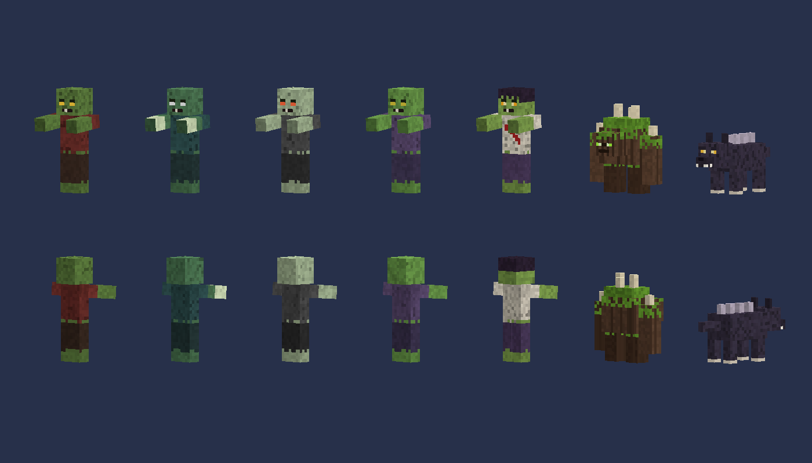

# Nightfall Mobs (Minecraft Bedrock add-on) - v0.1.0

Three new night mobs for survival, built as a **separate add-on** from Hearts & Lives. It works alone or next to it:
it never touches `player.json` or any vanilla file, and uses its own `nightfall:` names.

**Status: built and checked by automated tests. Not yet tested in the real game.** Nothing below has been seen
running on Windows or PS5 yet - see "What still needs a real test".



## What is in it

| Mob | What it does | Weakness |
| --- | --- | --- |
| **Gloomhound** | Fast night predator. Leaps at you. Alone or in pairs (plains, forests). | Light. Near torches it slows right down and cannot leap. |
| **Thornskulk** | Stands still like a bush until you are within 10 blocks, then rushes for 4 seconds (forests, taiga). | Gets tired for 5 seconds after each rush. Cannot rush in the light. |
| **Horde Stalker** | Rare. Sees you from 32 blocks, screams for 3 seconds, then calls **one** horde of weak zombies. | Kill it during the scream and no horde comes. |
| Horde Shambler / Skitter / Grasper / Brute | The horde: 14 (Easy) to 30 (Extreme) weak zombies in three waves. | Doors, walls and high ground. They cannot open or break doors or blocks, and they burn at sunrise. |

Items: Gloom Fang, Shadow Hide, Thorn Core, Bark Hide, Horde Claw, Tattered Cloth.

- **Shadow Hood** (helmet, Night Vision while worn): Shadow Hide, empty, Shadow Hide / Gloom Fang, empty, Gloom Fang / empty, String, empty.
- **Bramble Charm** (hold in the off hand; anything that hits you takes 2 damage): empty, String, empty / Bark Hide, Thorn Core, Bark Hide.

All the numbers and the reasoning are in [docs/BALANCE.md](docs/BALANCE.md).

## The difficulty book

Every player gets a **Nightfall Guide** the first time they join. Hold it and press Use.

- Everyone can read the mob guide.
- The **world host** (any operator) also gets buttons for **Easy / Normal / Hard / Extreme** and **Hordes On/Off**.
- Lost it or threw it away? Craft a new one anywhere: **1 planks + 1 stick** (works in the 2x2 inventory grid).

The setting is saved with the world and changes mobs that are already alive. Minecraft's own world difficulty still
applies on top, as it does for vanilla mobs.

## Install (Windows host)

```powershell
Invoke-Item -LiteralPath '<path to>\dist\nightfall-mobs-v0.1.0.mcaddon'
```

Then in the world settings turn on **both** packs: `Nightfall Mobs BP v0.1.0` (Behaviour Packs) and
`Nightfall Mobs RP v0.1.0` (Resource Packs). No experimental toggles are needed. Use a **copy** of a world you
care about for the first tests.

## Build from source

Needs Node.js 22 or newer. No other downloads.

```powershell
cd '.\prototypes\bedrock-nightfall-mobs'
npm run validate
```

That rebuilds `build/`, `dist/nightfall-mobs-vX.Y.Z.mcaddon` and `docs/BALANCE.md`, then runs the tests. The version
comes from `package.json` and appears in both pack names and the file name. Do not change `tools/uuids.json`: worlds
use those ids to recognise an upgrade.

Where things live:

- `src/scripts/balance.js` - **every number** (health, damage, speed, horde size, loot, spawn rates). Change balance here only.
- `src/scripts/main.js` - the in-game logic (guide book, difficulty, hordes, loot, gear).
- `tools/` - generates the entity files, models, textures and the package from the tables above.
- `test/` - 33 checks: the maths rules, every pack file, and the game script run against stand-in Minecraft modules.

## What still needs a real test

In a Creative copy of a world, with cheats on:

1. Both packs load with no red error text. You receive the Nightfall Guide; Use opens it; the host sees the difficulty buttons, a guest does not.
2. `/time set midnight`, then use each spawn egg (Creative, search "Gloomhound", "Thornskulk", "Horde"). Check each mob is visible, textured, walks and makes sound.
3. Switch to Survival. Gloomhound: fast and leaping in the dark, slow beside torches. Thornskulk: still until close, rush, then slow.
4. Horde Stalker: on seeing you it should roar and show a red warning; after 3 seconds a horn sounds and zombies arrive from 20+ blocks away in three groups. Kill another Stalker during its scream: no horde.
5. Kill a horde: only a handful of items should drop in total.
6. Craft and wear the Shadow Hood (Night Vision; check it shows on your head). Hold the Bramble Charm in the off hand and get hit.
7. Change difficulty in the guide and spawn a fresh mob; check it takes more or fewer hits.
8. Then the real thing: PS5 guest joins, sees the mobs and can open the guide. Watch performance during a 22-30 mob horde, including split-screen.

Most likely to need adjusting after the first test, because they can only be judged in the game: how far from a
torch the "light" behaviour starts, the Stalker's spawn rate, and how the models look in motion.

## Differences from the concept posters

- The posters' damage ranges became the difficulty ladder (see BALANCE.md).
- **Bramble Charm** pricks attackers instead of giving knockback resistance. Bedrock only lets an add-on change a player's knockback resistance by replacing `player.json`, which Hearts & Lives already owns.
- The Horde Stalker does not climb walls, so high ground and walls stay safe. Horde Toxin, traps, lures and horde-resistant armour are not made yet; Horde Claw and Tattered Cloth drop now so they are ready when those recipes are chosen.
- Shadow Hide and Bark Hide are 20% drops; the hood and charm each take roughly 10 kills.
- The models and textures are simple blocky originals made for this pack. They follow the posters' colours and shapes but are much plainer than the poster art.
